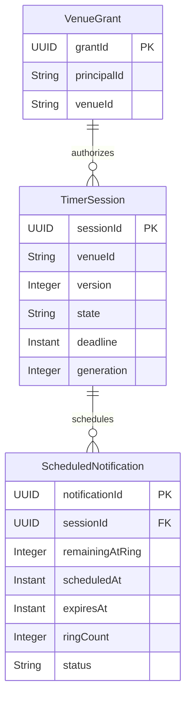
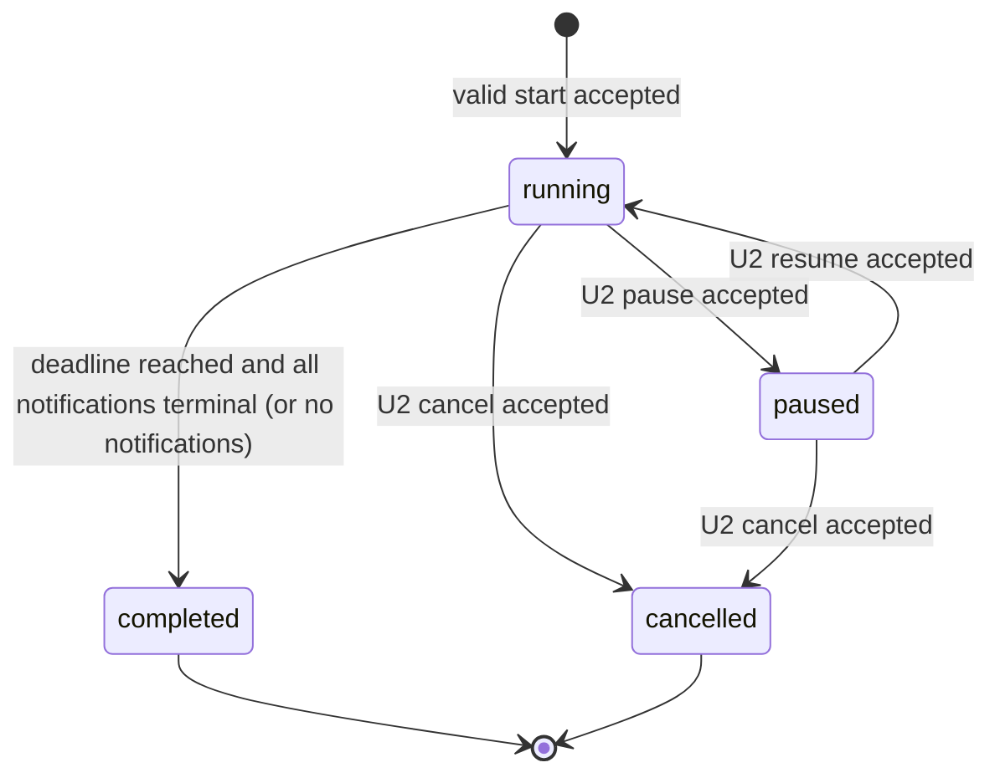
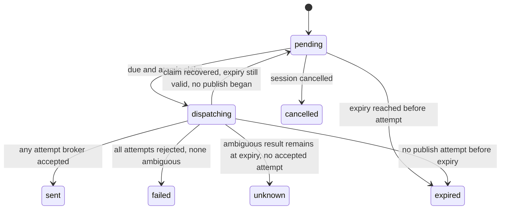

# U1 統合タイマーの振る舞い

入力: [U1の範囲](../../../inception/units-generation/unit-of-work.md)、[ストーリー割当](../../../inception/units-generation/unit-of-work-story-map.md)、[stories.md](../../../inception/user-stories/stories.md)、[requirements.md](../../../inception/requirements-analysis/requirements.md)、[components.md](../../../inception/domain-design/components.md)、[contract-summary.md](../../../inception/contract-design/contract-summary.md)、[U1データモデル](entities.md)、[U1業務ルール](rules.md)、[回答](functional-design-questions.md)。

## 範囲と所有境界

U1は認証済み主催者から開始要求を受け、入力を検証し、設定を固定したTimerSessionとScheduledNotification群を永続化する。バックエンドはUTC deadlineを基準に通知を予定し、AWS IoT CoreへMQTT命令を送る。OperatorInterfaceは状態と送信結果を表示する。Picoは受け取った命令を処理するだけであり、このシステムのタイマー全体を動かさない。

U1の公開APIはC1の状態取得・開始を実装対象とする。設定保存APIと完成画面はU3、pause/resume/cancelと競合回復の完成はU2で拡張する。U1ではその後の拡張に備えversion、generation、pausedを含む共有モデルを定義するが、未実装操作を画面で成功と表示しない。認証発行者、データベース、待機機構、AWS配備形態は後続設計で決める。

## エンティティ関係図

<!-- Text fallback: VenueGrant authorizes a principal for a venue; one TimerSession owns zero to ten ScheduledNotification records. -->

図は[entities.md](entities.md)のYAML正本から導出した要約である。

## 状態モデル

<!-- Text fallback: A valid start creates a running session. U2 may pause, resume, or cancel it. With no notifications it completes at its deadline; otherwise it completes after the deadline and all notifications reach terminal outcomes. Completed and cancelled sessions are terminal. -->

`remainingSeconds`はdeadlineまでの残りを秒単位で返す。各sessionには通知の有無によらずdeadline起床を登録する。通知が0件なら正常起床時にdeadlineでcompletedにする。通知が1件以上ある場合はdeadline経過かつ全通知がsent/failed/unknown/expired/cancelledの終端状態になってからcompletedにする。表示が0になっても未確定通知があればrunningを保ち、画面は「終了ベル処理中」を表示する。通常の通知期限はscheduledAt+5秒。独立再照合は60秒ごとに行う。deadline起床が失われた場合、通知0件はdeadline+65秒以内に完了状態を保存する。通知がある場合はmax(deadline, 最新notification.expiresAt+65秒)以内に完了状態を保存する。終了時通知のexpiresAtはdeadline+5秒なので、回復時はdeadline+70秒までを目標とする。これらはサービスのハードリアルタイム保証ではなく、監視する運用目標である。命令のexpiresAtを超えてpublishを再開しない。

各通知状態:

<!-- Text fallback: A pending notification is atomically claimed when due. It ends as sent if any attempt is accepted, failed if all attempts are definitely rejected without ambiguity, unknown if ambiguity remains at expiry, expired if no attempt began, or cancelled. A recovered claim may return to pending only if no publish began and expiry remains. Internal dispatching is projected to public pending and labeled “送信処理中” in the UI. -->

## 主な処理手順

### 開始

1. AccessControlがbearer token、会場grant、操作権限を確認する。拒否時は保護対象データを返さない。
2. TimerControlはAPI入力を検証する。時間は1〜10800秒、通知は最大10件、各時刻は一意かつ時間範囲内、各ringCountは1/2/3、隣接する予定間隔は2秒以上である。
3. `Idempotency-Key`と会場、主催者、経路、本文指紋を確認する。同一キー・同一内容の確定済み再試行には保存済み応答を返す。異なる本文なら409。別の進行中セッションがあれば作成しない。
4. サーバーUTC時刻でsessionId、settingsSnapshot、deadline、version=1、generation=1、各notificationIdを生成する。全TimerSessionと通知を耐久保存してから成功を返す。
5. 各通知に `scheduledAt = deadline - remainingAtRing` と `expiresAt = scheduledAt + 5秒` を設定する。remainingAtRing=durationSecondsは開始直後、0は終了時である。
6. セッションdeadlineと各通知の起床登録は、永続化と同一トランザクションだと仮定しない。TimerSession/ScheduledNotificationは予定登録状態、登録キー、登録試行番号を耐久保存する。登録キーは対象ID・generation・用途・試行番号から決定し、同じ試行の再送は同じキーと同じ入力を使う。受付結果が曖昧な場合は同一キーの登録状態を照合し、新しい試行番号を発行しない。登録失敗が確定した場合だけ条件付き更新で試行番号を増やして再登録する。複数の起床が存在しても、起床処理はDynamoDB相当の正本状態と条件付きclaimで重複副作用を防ぐ。照合処理は未登録・失敗・期限切れの予定を再試行する。耐久保存済みの開始を「存在しない」と誤報しない。
7. 最初の状態応答はサーバー時刻を含む。ブラウザーは値を補間表示し、再表示時はGET stateで復元する。

### 起床とベル命令送信

1. 起床要求はsessionId、generation、notificationIdを持つ。ハンドラーは信頼された内部経路からのみ受け付ける。
2. TimerControlは永続状態を読み直す。sessionがrunningで、generation一致、notificationがpending、scheduledAt到達、expiresAt未到達の場合だけ、条件付き更新で短いclaimを取得する。早すぎる起床は再予定し、古い・重複・取消済み・期限切れの起床は送信しない。
3. commandIdにはnotificationIdを使い、command payloadを固定する。claim後にストアのトランザクション外でAWS IoT CoreへQoS 1・retain=falseで発行する。
4. 受付が明確ならstatus=sent、dispatchOutcome=acceptedとする。永続化の再試行でも同じclaim tokenとcommandIdで重複適用を防ぐ。AWS受付はPicoの受信や実際の鳴動を意味しない。
5. 結果が不明なら同じcommandId・同じpayloadで、残り期限内だけ短い間隔で再試行する。いずれかの試行で受付が確認できればstatus=sent。受付が一度もなく曖昧な試行が残ったまま期限を迎えればstatus=unknown。不受理だけが確定し曖昧な試行がなければstatus=failed。再試行で新しいIDを作らない。
6. 予定時刻から5秒以上経過した後は送信しない。試行前に期限切れならexpired。起床消失や処理中claimの回復のため、独立した照合処理を60秒間隔で実行し、各notificationのexpiresAt+65秒以内に通知の終端状態を保存することを運用目標とする。照合は期限後のpublishを開始しない。
7. MQTT QoS 1では重複配信の可能性があるため、Picoは同じcommandIdを重複実行しない。ベルの返信がないので、アプリはPicoのオンライン状態・受信・打音成功を表示しない。

### 障害回復と時刻端点

- ブラウザー切断はsessionや待機処理を止めない。状態GETに失敗した画面は最終取得時刻と更新失敗を示し、古い応答でより新しい表示を上書きしない。
- 処理中のclaimは期限付きである。claim期限後、照合処理は通知の期限・送信開始記録・累積送信結果を再確認する。未送信が確実で期限内なら同じIDの試行を継続し、送信の可能性が残るなら期限まで追跡しunknownにする。60秒ごとの独立照合で、expiresAt+65秒以内に通知の終端結果を永続化することを目標とする。
- スケジューラが遅れて起床し、まだ5秒の有効期限内なら送信を試みる。期限を過ぎた通知は送らず記録する。既に届いた古いMQTT命令をPicoが期限で破棄する契約も維持する。
- 通知があるsessionはdeadline経過後かつ全通知の終端結果が確定するまでrunning・remainingSeconds=0を返す。通知0件ならdeadline起床でcompletedにする。画面は0秒で終了ベル処理中を明示する。期限起床が失われた場合の完了目標は、通知0件ならdeadline+65秒、通知ありならmax(deadline, 最新notification.expiresAt+65秒)である。終了時通知ではdeadline+70秒になる。正常起床なら通知結果確定後に完了し、復旧目標は通知期限や送信期限を延長しない。
- U2が追加するpause/cancelは同じTimerControl所有権とversionを使う。送信claimが確定する前にpause/cancelが先行した場合は通知を無効化し、claimが先行した場合は送信結果または期限によるunknown確定まで操作応答を待つ。

## API・画面との対応

| 操作 | U1で定める結果 |
|---|---|
| `GET /v1/state` | serverTimeと現在または直近session。未作成時はsession=null。実行中のremainingSecondsはサーバー計算値。 |
| `POST /v1/sessions` | settingsまたはsavedSettingsVersionの片方を受け、冪等な開始を行う。U1ではinline settings、U3は保存版を使う。 |
| 状態変更API | pause/resume/cancelはU2で実装。既知のC1契約に従いversionと同一Idempotency-Keyを使う。 |
| 通知結果表示 | pending、sent、failed、expired、cancelled、unknownを文字で区別する。unknownを成功と表現しない。 |

## エラーと境界条件

| 状況 | 振る舞い |
|---|---|
| 不正な時間・通知件数・重複時刻・2秒未満の間隔 | 400 VALIDATION_ERROR。どの項目を直すか返し、状態は作らない。 |
| 未認証・許可外主催者 | 401または403。タイマー・設定・通知の情報は漏らさない。 |
| 有効な状態で別の開始要求 | 409 ACTIVE_SESSION。既存状態を読み直すよう促す。 |
| 古いexpectedVersion | 409 VERSION_CONFLICT。自動で上書きしない。 |
| 同一キーを別の本文に再利用 | 409 IDEMPOTENCY_CONFLICT。 |
| ストアまたは待機登録が一時利用不可 | 503または処理中として表す。耐久保存前の操作を成功表示せず、登録可能な通知は回復処理で照合する。 |
| 状態取得が失敗または応答順が逆転 | 最終更新時刻を残して古い状態と示す。より古い要求の応答を破棄する。 |
| 開始直後の通知 | `remainingAtRing=durationSeconds`として即時予定。開始成功の耐久保存後にのみ送信可能。 |
| 通知なしのタイマー | タイマー表示・完了を行い、通知処理は作成しない。 |
| 終了時通知 | deadlineに予定。notificationが確定するまでremaining=0、runningを保つ。 |

## U1から後続Unitへの引き継ぎ

- U2はpause/resume/cancel、generation更新、claimとの競合と回復、送信結果不明の画面表示を追加する。
- U3は次回用設定一組を保存するAPIと完成画面を追加し、開始時に最新の保存版をsnapshot化する。
- AWSの具体的な待機・排他・永続化サービス、認証方式、環境、費用はNFR/Infrastructure Designで確定する。論理上必要な耐久保存、条件付きclaim、重複起床耐性、期限切れ照合はこの仕様の必須動作である。

## ルール要約

| ルール | 動作 |
|---|---|
| BR1.1–BR1.2 | サーバーで認可・入力値・2秒間隔を検証する。 |
| BR1.3–BR1.5 | 1会場1件、冪等開始、UTC deadlineを一貫して用いる。 |
| BR1.6–BR1.8 | 起床ごとに状態を再検査し、期限内claimのみ発行する。 |
| BR1.9–BR1.10 | 不明結果は同じIDで期限内のみ再試行し、sentと鳴動成功を区別する。 |
| BR1.11–BR1.13 | 終了ベルを損なわず完了させ、永続化・記録・秘密保持を定める。 |
