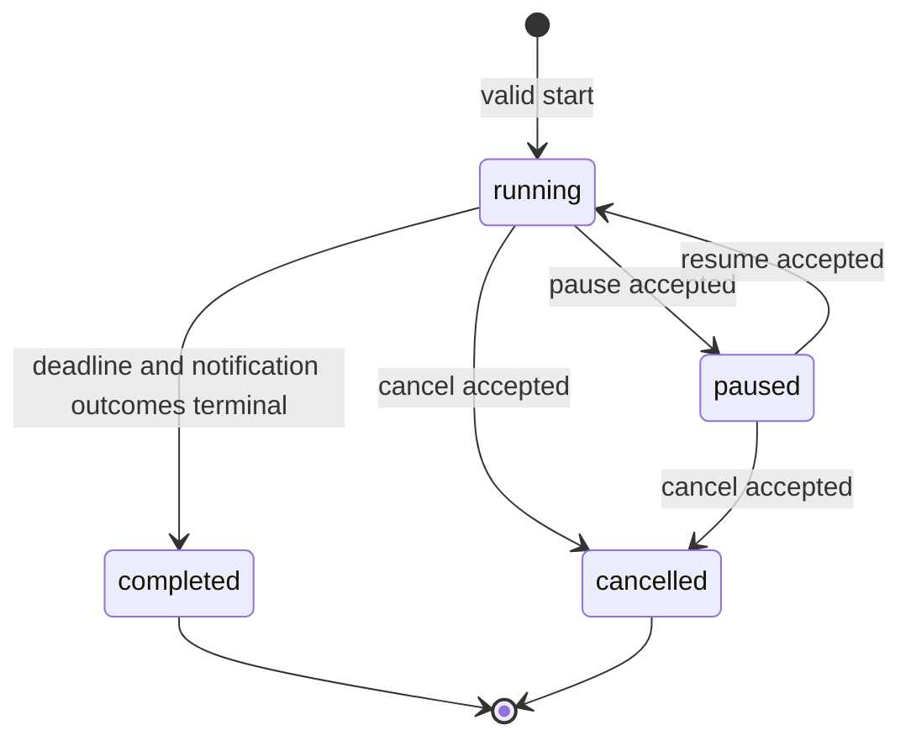

# U2 タイマー制御の振る舞い

入力: [実装単位](../../../inception/units-generation/unit-of-work.md)、[ストーリー割当](../../../inception/units-generation/unit-of-work-story-map.md)、[stories.md](../../../inception/user-stories/stories.md)、[requirements.md](../../../inception/requirements-analysis/requirements.md)、[components.md](../../../inception/domain-design/components.md)、[contract-summary.md](../../../inception/contract-design/contract-summary.md)、[U2データモデル](entities.md)、[U2業務ルール](rules.md)、[回答](functional-design-questions.md)。

## 範囲と所有境界

U2はTimerControlのpause / resume / cancel、状態版の競合検出、通知dispatchとの直列化、冪等な操作結果を追加する。状態取得・開始・通知送信はU1のC1/C2契約を維持し、保存済み設定APIと完成画面はU3が所有する。画面ではU1の最小画面に制御操作を加え、サーバーが返した状態を表示する。AWS実装方式と物理UIの完成仕様は後続工程で決める。

## 状態モデル

<!-- Text fallback: running may pause, complete, or cancel; paused may resume or cancel; completed and cancelled are terminal. -->

各セッションはU1の単一会場制約を維持する。`version`は受理された各状態変更で一度だけ増え、`generation`はresumeごとに増える。停止中は残り時間を固定し、期限・通知予定・失効時刻を持たない。再開は新しい期限を作りpending通知のみを再配置する。終端通知の結果と終端セッションは変更しない。

## 操作ワークフロー

### Pause

1. `operate`権限、sessionId、Idempotency-Key、expectedVersionを検証する。
2. 同じキーの既存receiptがあれば、本文指紋一致時は保存済み結果を返す。不一致は`IDEMPOTENCY_CONFLICT`、未確定は`IN_PROGRESS`と`Retry-After: 1`を返す。
3. 現在状態がrunningであること、expectedVersionが一致することを永続状態で検査する。
4. pauseと通知claimの条件付き更新を競合させる。pauseが先に成立した場合、状態をpausedへ、残り時間をserverTimeから計算して固定し、deadlineをnullにし、pending通知のscheduledAt/expiresAtをnullにして旧世代を無効化する。
5. dispatch claimが先に成立済みなら同じnotificationIdの結果が受付確認・確定拒否・期限切れのいずれかに確定するまで操作結果を完了させない。HTTP待機上限を超えた場合は同じキーで`IN_PROGRESS`を返し、別キーの操作を作らない。
6. 状態と操作receiptを耐久保存してから200と新しいStateを返す。

### Resume

1. 認可、冪等キー、期待版を検証し、未完了処理の照合を行う。
2. 状態がpausedである場合だけ、残り時間から`deadline=serverTime+remainingSeconds`を計算してrunningへ遷移する。
3. generationとversionを各1増やし、pending通知だけを`scheduledAt=deadline-remainingAtRing`、`expiresAt=scheduledAt+5秒`に設定する。
4. 通知登録の受付が遅延または不明でも状態の耐久記録を維持する。照合処理はgenerationと通知状態を照合して登録を修復し、古い起床は副作用のない処理として捨てる。
5. 状態と操作receiptを耐久保存してから200を返す。sent、failed、expired、cancelled、unknownは再配置しない。

### Cancel

1. 認可、冪等キー、期待版を検証し、状態がrunningまたはpausedであることを確認する。
2. cancelと通知claimの条件付き更新を競合させる。cancelが先なら状態をcancelledへ、deadlineをnullにし、pending通知をcancelledへ更新して現世代を無効化する。
3. dispatch claimが先に成立済みなら、対象コマンドの結果が確定するか期限切れになるまで成功を返さない。受付済みコマンドは取り消せない。
4. 状態と操作receiptを耐久保存してから200を返す。completed / cancelled / invalid-stateへの取消し要求は409とし、別の状態を作らない。

## 状態変更APIと応答

| 操作 | 許可状態 | 受理後 | 主な競合・失敗 |
|---|---|---|---|
| `POST /v1/sessions/{id}/pause` | running | paused、残り時間固定、version+1 | stale版は409 VERSION_CONFLICT、他状態は409 INVALID_STATE、同キー未確定は409 IN_PROGRESS |
| `POST /v1/sessions/{id}/resume` | paused | running、新deadline、新generation、version+1 | stale版は409、既送信通知は再送しない |
| `POST /v1/sessions/{id}/cancel` | running / paused | cancelled、pending通知を無効化、version+1 | claim先行時は解決まで成功を保留、既送信は取消不能 |

全操作は`Idempotency-Key` UUIDと`expectedVersion`を必須とする。操作キーは会場・主催者・経路・sessionId・本文と結び付け、7日間保持する。同じキー/同じ本文の確定済み再試行には初回の状態応答を返す。別本文での再利用は409 IDEMPOTENCY_CONFLICT。操作応答は耐久保存後に限り成功とする。

## 競合の直列化と回復

pause/cancelと通知送信は同じ永続状態に対する条件付き更新で順序付ける。送信許可取得前の通知claimよりpause/cancelが先に確定した場合、通知は送らずpending通知を停止・取消し状態へ進める。claimが先の場合はstable commandIdを維持し、AWS IoT Coreの受付確認または失効期限による確定まで止める操作の成功を返さない。結果不明は期限までは回復中として扱い、期限後はunknownで確定し、受理済みと偽装しない。

resumeは新generationを発行し、旧generationのwakeを無効化する。notificationIdとpayloadは同じ通知の再登録・dispatch再試行で維持する。未送信pending通知のみが再予定される。再照合はU1で定めた周期・上限目標に従い、失敗時にも耐久状態を失わない。

## 画面状態とエラー

- runningでは残り時間、pauseとcancelの操作可否、各通知の予定/送信結果を表示する。
- pausedでは固定残り時間とresume/cancelを表示する。クライアント時計だけで進行させない。
- cancelled / completedでは終端状態を表示し、新規操作を無効化する。
- 更新中は重複操作を抑止する。API通信失敗・503・画面復帰時はstateを再取得し、状態変更の再試行は元のIdempotency-Keyを使う。
- 409 VERSION_CONFLICT / INVALID_STATEではサーバーの最新stateを取得し、古い表示を成功状態に上書きしない。
- 409 IN_PROGRESSは処理結果未確定と表示し、同じキーで再照会する。
- 401/403、404、400は自動再試行せず、再認証・対象確認・入力修正を案内する。
- unknownは「送信結果不明」と表示する。Picoの接続状態や実鳴動成功を示す表現をしない。

## 検証境界

自動試験はpause/cancelとclaimの順序両方、stale version、同一キー再送、別本文のキー再利用、通知登録応答不明からの照合、resume後の旧generation wake、再開時の送信済み通知非再送を検証する。模擬受信環境による契約確認はAC1.8.1の証拠として扱う。Pico実機の30回鳴動性能と期限切れ/重複命令拒否（AC1.8.2 / AC1.8.3）は実機準備後に別途実施し、未実施中はDeferredと記録する。機構復帰時間が未確定なら近接通知間隔の安全性を合格扱いしない。

## U2から後続Unitへの引き継ぎ

- U3は保存設定API、完成画面、取消し確認、アクセシビリティ、実機試験の手順・結果記録を追加する。
- U1のTimerControl / BellTransport契約、状態の意味、通知結果区分、資格情報境界を変更しない。
