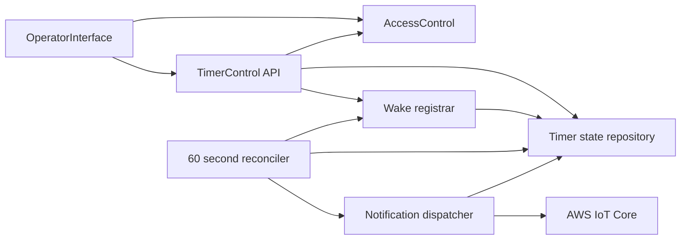

# U2 論理コンポーネントと障害境界

入力: [U2機能仕様](../functional-design/functional-spec.md)、[NFR要件](../nfr-requirements/)、[components.md](../../../inception/domain-design/components.md)、[contract-summary.md](../../../inception/contract-design/contract-summary.md)。

<!-- Text fallback: The browser calls authenticated TimerControl API. API/recovery handlers share durable TimerSession/Notification/OperationReceipt state; wake registration and reconciliation are separate retryable boundaries, and only dispatcher reaches IoT. -->

| Component | State ownership / failure boundary | Recovery and blast radius |
|---|---|---|
| OperatorInterface | 選択中のsession表示、未送信UI操作keyのみ | 通信断で古いstateを明示し、サーバー状態変更は推定しない。 |
| AccessControl | principalから共有venue grantの権限照合 | deny-by-default。認証失敗はsessionデータ変更に波及しない。 |
| TimerControl API | 期待版検証、状態変更、U1 OperationReceiptの確定 | repository条件付き更新で競合を直列化し、未確定時は409 IN_PROGRESS。 |
| Timer state repository | TimerSession, notification, wake state, pendingOperation, operationResults | セッション版/generationと通知claimで一貫性を守る。ストア障害は503。 |
| Wake registrar | deterministic state machine executionの登録結果 | same name/input照合、terminal failure時のみattempt更新。 |
| Reconciler | 欠落wake・期限切れleaseの定期修復 | session単位で再処理し、一つの不具合が他会場へ波及しない。初版は会場1つ。 |
| Notification dispatcher | 条件付きclaim後のMQTT publishと結果分類 | stable commandId・expiry・cumulative outcomeで回復する。 |

永続データ所有はU1 TimerControlの単一repository境界に集約し、U2専用データベース・サービスを追加しない。AWS resource、IAM role、アラームはInfrastructure Designで割り当てる。

## 品質・検証境界

API/domain、repository条件付き更新、wake登録/reconciliation、notification dispatcherを独立した単体試験境界とし、各層の実装後に試験を追加する。主要な結合試験はpause/resume/cancel、同一idempotency keyの再送、version競合、期限切れlease、wake登録の曖昧応答・回復を扱う。Build and Testはアプリケーション全体で行カバレッジ80%以上を確認し、CIはtest、format、static analysis/typecheckを統合前に実行する。U2単体試験だけを全体カバレッジ判定に使わない。
