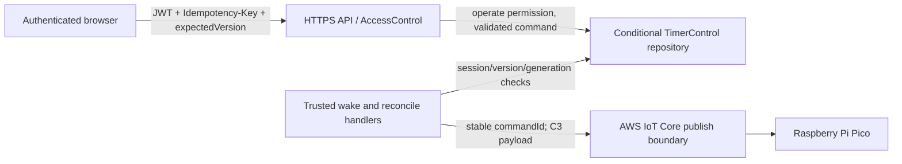

# U2 セキュリティ設計

入力: [セキュリティ要件](../nfr-requirements/security-requirements.md)、[U2機能仕様](../functional-design/functional-spec.md)、[U2業務ルール](../functional-design/rules.md)、[contract-summary.md](../../../inception/contract-design/contract-summary.md)。

## 信頼境界

<!-- Text fallback: Browser control requests enter the HTTPS API; API authorization and durable conditional writes precede trusted wake/reconcile handlers. Only checked handlers publish to IoT. -->

- API Gateway等のHTTPS境界でJWTを検証し、AccessControlが会場をprincipalに紐付けて`operate` permissionを照合する。venueIdはブラウザーの値で決めない。
- request bodyはC1 schemaで厳格検証し、`expectedVersion`はサーバーの現行版と比較する。古い版を自動上書きしない。
- `OperationReceipt`はU1と同じ論理形状（`idempotencyKey`, `route`, `requestFingerprint`, `responseStatus`, `responseBody`, `expiresAt`）を使う。session上の`pendingOperation`は別に保持し、処理のroute、sessionId、principalId、expectedVersion、lease token/期限を保存する。credentialや生JWTは保持しない。
- lease期限切れ時のreconcilerは`pendingOperation`と永続session version/stateを再読込し、遷移が未実行なら条件付きで再開、遷移済みなら同じ応答のreceiptを完成する。外部publish未確定中は成功を推定しない。
- browserからAWS SDK/MQTTやcredentialを使わせない。バックエンドのIAMはvenue control repository、Step Functions execution、許可したIoT topicに限る。
- ログではrequest bodyを全面記録せず、相関ID・route・結果分類・版番号のみを記録する。XSS/CSRF対策のヘッダーやcookie属性はU1のWeb配信構成を継承する。

## 認証失敗の振る舞い

未認証は401、認証済みのread-only / 許可外 principalは403。いずれもsession、notification、operation receiptを変更せず、対象会場の存在を漏らさない。
