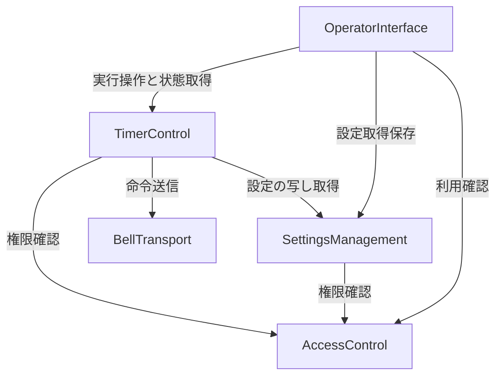

# アプリの論理構成
入力: [requirements.md](../requirements-analysis/requirements.md)、[stories.md](../user-stories/stories.md)、[team-practices.md](../practices-discovery/team-practices.md)、[質問回答](domain-design-questions.md)。
この一覧は実装する論理部品であり、デプロイ先や技術スタックの確定ではない。YAMLブロックはYAML 1.2で有効なJSON形式を使用する。

```yaml
{
  "components": [
    {
      "name": "OperatorInterface",
      "summary": "主催者向けの画面と操作入力",
      "behaviour": "進行と設定をタブで分離し、サーバー状態で表示する。未取得・古い状態から操作を成功扱いしない。送信受付と鳴動を区別する。",
      "responsibilities": [
        "入力下書きと表示状態",
        "開始・停止・再開・取消しの操作要求",
        "入力補助とアクセシビリティ"
      ],
      "depends_on": [
        {
          "component": "AccessControl",
          "interaction": "利用可否とログインを確認",
          "style": "sync"
        },
        {
          "component": "SettingsManagement",
          "interaction": "次回設定の取得・保存",
          "style": "sync"
        },
        {
          "component": "TimerControl",
          "interaction": "実行操作と現在状態・通知結果の取得",
          "style": "sync"
        }
      ],
      "dependents": [],
      "entities": []
    },
    {
      "name": "AccessControl",
      "summary": "許可された主催者と会場の操作権限",
      "behaviour": "認証情報を会場権限へ対応付ける。未認証・許可外の読取と操作を拒否する。一般自己登録を提供しない。",
      "responsibilities": [
        "主催者と会場の権限判定",
        "認証基盤との境界"
      ],
      "depends_on": [],
      "dependents": [
        {
          "component": "OperatorInterface",
          "interaction": "ログインと利用可否"
        },
        {
          "component": "SettingsManagement",
          "interaction": "会場設定の操作権限確認"
        },
        {
          "component": "TimerControl",
          "interaction": "実行・状態参照の権限確認"
        }
      ],
      "external_dependencies": [
        {
          "name": "認証基盤（後続で選定）",
          "kind": "third-party-api",
          "purpose": "主催者の本人確認"
        }
      ],
      "entities": [
        {
          "name": "VenueGrant",
          "identifier": "grantId",
          "attributes": [
            "grantId",
            "principalId",
            "venueId",
            "permissions"
          ],
          "references": []
        }
      ]
    },
    {
      "name": "SettingsManagement",
      "summary": "会場の次回用設定1組の所有",
      "behaviour": "時間とベル設定を検証して上書き保存する。実行開始時には設定の写しを渡し、後の編集で実行中の設定を変えない。",
      "responsibilities": [
        "SavedSettingsの唯一の書込み所有者",
        "設定版の競合検出",
        "時間・通知設定の検証"
      ],
      "depends_on": [
        {
          "component": "AccessControl",
          "interaction": "設定操作の権限確認",
          "style": "sync"
        }
      ],
      "dependents": [
        {
          "component": "OperatorInterface",
          "interaction": "取得・保存"
        },
        {
          "component": "TimerControl",
          "interaction": "開始時の設定スナップショット取得"
        }
      ],
      "external_dependencies": [
        {
          "name": "永続化ストア（後続で選定）",
          "kind": "database",
          "purpose": "保存設定の保持"
        }
      ],
      "entities": [
        {
          "name": "SavedSettings",
          "identifier": "venueId",
          "attributes": [
            "venueId",
            "version",
            "durationSeconds",
            "bellPoints",
            "updatedAt"
          ],
          "references": []
        }
      ]
    },
    {
      "name": "TimerControl",
      "summary": "タイマー状態と予定通知・送信可否の一元管理",
      "behaviour": "会場の同時実行を制御し、バックエンド時刻で開始・停止・再開・取消しを確定する。予定通知と送信可否も同じ所有者で管理し、古い予定や期限切れを送らない。",
      "responsibilities": [
        "TimerSessionとScheduledNotificationの唯一の書込み所有者",
        "操作識別子による重複抑止と競合順序の確定",
        "待機処理への予定登録と起床時の状態再検査",
        "送信受付・失敗・不明結果の記録と状態提供"
      ],
      "depends_on": [
        {
          "component": "AccessControl",
          "interaction": "利用者からの実行・参照要求を認可",
          "style": "sync"
        },
        {
          "component": "SettingsManagement",
          "interaction": "開始時の設定を固定",
          "style": "sync"
        },
        {
          "component": "BellTransport",
          "interaction": "送信を許可した通知の外部送信",
          "style": "sync"
        }
      ],
      "dependents": [
        {
          "component": "OperatorInterface",
          "interaction": "実行操作と結果表示"
        }
      ],
      "external_dependencies": [
        {
          "name": "バックエンド待機機構（後続で選定）",
          "kind": "other",
          "purpose": "予定時刻に起床を要求する。起床自体は送信権限を持たない"
        },
        {
          "name": "永続化ストア（後続で選定）",
          "kind": "database",
          "purpose": "実行状態・通知・操作結果の耐久保存"
        }
      ],
      "entities": [
        {
          "name": "TimerSession",
          "identifier": "sessionId",
          "attributes": [
            "sessionId",
            "venueId",
            "version",
            "state",
            "settingsSnapshot",
            "remainingSeconds",
            "deadline",
            "generation",
            "operationResults",
            "createdAt",
            "updatedAt"
          ],
          "references": [
            {
              "entity": "SavedSettings",
              "owned_by": "SettingsManagement",
              "relationship": "開始時の設定版を出典として保持し、実行値は写しを所有"
            }
          ]
        },
        {
          "name": "ScheduledNotification",
          "identifier": "notificationId",
          "attributes": [
            "notificationId",
            "sessionId",
            "generation",
            "remainingAtRing",
            "scheduledAt",
            "expiresAt",
            "ringCount",
            "status",
            "dispatchOutcome"
          ],
          "references": []
        }
      ]
    },
    {
      "name": "BellTransport",
      "summary": "ベル命令の外部通信境界",
      "behaviour": "許可された命令をAWS IoT Coreへ送信し、受付・失敗・結果不明を返す。タイマー状態を書き換えず、独自の古い命令再送や鳴動成功判定を行わない。",
      "responsibilities": [
        "命令とMQTT形式の変換",
        "実サービスと模擬受信を切り替え可能なポート",
        "送信結果の分類"
      ],
      "depends_on": [],
      "dependents": [
        {
          "component": "TimerControl",
          "interaction": "ベル命令送信"
        }
      ],
      "external_dependencies": [
        {
          "name": "AWS IoT Core",
          "kind": "third-party-api",
          "purpose": "対象PicoへのMQTT配信"
        },
        {
          "name": "Raspberry Pi Pico（依頼者実装）",
          "kind": "other",
          "purpose": "0.5秒間隔で1/2/3回鳴らす。期限・識別子を検査し、返信しない"
        }
      ],
      "entities": []
    }
  ]
}
```

## Component Diagram

<!-- Text fallback: OperatorInterface calls AccessControl, SettingsManagement, and TimerControl. SettingsManagement calls AccessControl. TimerControl calls AccessControl, SettingsManagement, and BellTransport. -->
構文を確認: 全5ノードを宣言し、7本の依存辺と対応させた。自己参照・循環はない。

## Component Summary
| Component | Purpose | Depends On | Dependents | Entities Owned |
|---|---|---|---|---|
| OperatorInterface | 主催者向けの画面と操作入力 | AccessControl, SettingsManagement, TimerControl | None | None |
| AccessControl | 許可された主催者と会場の操作権限 | None | OperatorInterface, SettingsManagement, TimerControl | VenueGrant |
| SettingsManagement | 会場の次回用設定1組の所有 | AccessControl | OperatorInterface, TimerControl | SavedSettings |
| TimerControl | タイマー状態と予定通知・送信可否の一元管理 | AccessControl, SettingsManagement, BellTransport | OperatorInterface | TimerSession, ScheduledNotification |
| BellTransport | ベル命令の外部通信境界 | None | TimerControl | None |

## Entity Ownership
| Entity | Owning Component | Identifier | Attributes | References |
|---|---|---|---|---|
| VenueGrant | AccessControl | grantId | grantId, principalId, venueId, permissions | None |
| SavedSettings | SettingsManagement | venueId | venueId, version, durationSeconds, bellPoints, updatedAt | None |
| TimerSession | TimerControl | sessionId | sessionId, venueId, version, state, settingsSnapshot, remainingSeconds, deadline, generation, operationResults, createdAt, updatedAt | SavedSettings (SettingsManagement) |
| ScheduledNotification | TimerControl | notificationId | notificationId, sessionId, generation, remainingAtRing, scheduledAt, expiresAt, ringCount, status, dispatchOutcome | None |
ScheduledNotificationのsessionIdは同じ所有者のTimerSessionを参照する。型・値域・関連件数はFunctional Designで定義する。画面下書きと外部送信結果は独立した永続エンティティにしない。

## External Dependencies
| Component | Dependency | Kind | Purpose |
|---|---|---|---|
| AccessControl | 認証基盤（後続で選定） | third-party-api | 主催者の本人確認 |
| SettingsManagement | 永続化ストア（後続で選定） | database | 保存設定の保持 |
| TimerControl | バックエンド待機機構（後続で選定） | other | 予定時刻に起床を要求する。起床自体は送信権限を持たない |
| TimerControl | 永続化ストア（後続で選定） | database | 実行状態・通知・操作結果の耐久保存 |
| BellTransport | AWS IoT Core | third-party-api | 対象PicoへのMQTT配信 |
| BellTransport | Raspberry Pi Pico（依頼者実装） | other | 0.5秒間隔で1/2/3回鳴らす。期限・識別子を検査し、返信しない |

## 境界の選択肢
- A: タイマー状態・通知状態・送信可否をTimerControlに集約する。停止と送信の順序を一箇所で扱えるが、部品はやや大きくなる。内部モジュール分割は可能。
- B: タイマーと独立した通知管理部品を設ける。分離して拡張しやすいが、停止時の無効化と送信可否の整合を部品間で調停する必要がある。
- 推奨: A。1会場・同時1件の初版では整合性を優先する。承認時にこの分割案を選択する。

## Rationale
| Component | 分離理由 |
|---|---|
| OperatorInterface | スマホ表示と下書きの寿命はサーバー実行状態と異なる |
| AccessControl | 本人確認・許可関係の変更を時間計算から分離する |
| SettingsManagement | 保存設定は次回用に変更でき、固定した実行設定と寿命が異なる |
| TimerControl | 実行・通知・送信可否は停止や取消しで同時に変化し、一つの所有者にする |
| BellTransport | 外部サービスの形式と送信失敗を隔離し、模擬受信で検証できる |
Alternatives Rejected: 独立通知管理は初版の調停複雑性を増やすため提案しない。画面から直接MQTT送信する案はバックエンド時間管理・資格情報の境界に反する。永続化や認証基盤は外部依存であり部品数に含めない。

## 状態と外部送信の境界
開始時の写しと次回保存設定を区別し、終了後の新規開始には最新の保存済み次回設定を使う。未保存下書きは使わず、開始前に時間・通知の概要を返す。
待機機構は起床要求のみを担い、古い世代の起床で送信しない。TimerControlは送信前の状態と世代を確認し、状態変更と送信許可取得の順序を調停する。外部送信との完全な原子性は仮定しない。送信許可を取得済みの処理がある停止・取消しは、送信の成否または期限切れが確定するまで成功応答せず、結果不明を失敗へ偽装しない。具体的な競合制御・回復・タイムアウトはFunctional Designで確定する。
送信した命令は取消せない。Picoは重複識別子と期限切れを抑止する契約を持ち、返信は不要。0.5秒間隔では3打の開始は0/0.5/1秒だが、機構の復帰時間は未検証。通知の安全な最小間隔は契約設計と実機確認で確定し、未確定のまま近接通知を安全と扱わない。

## セキュリティと検証責任
外部からの参照・操作はAccessControlの判定をサーバーでも適用する。待機処理の内部起床は主催者の偽装ではなく信頼された実行経路として検証する。通信暗号化と対象リソース・トピック外への拒否を後続NFRの検証に引き継ぐ。実機は早ければ11月13日という未確定の見込みで、模擬成功を実鳴動成功にしない。
